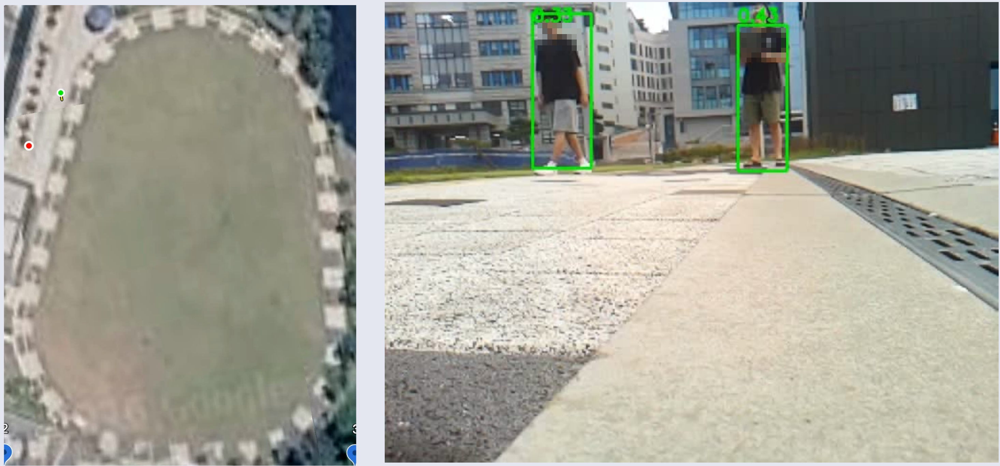
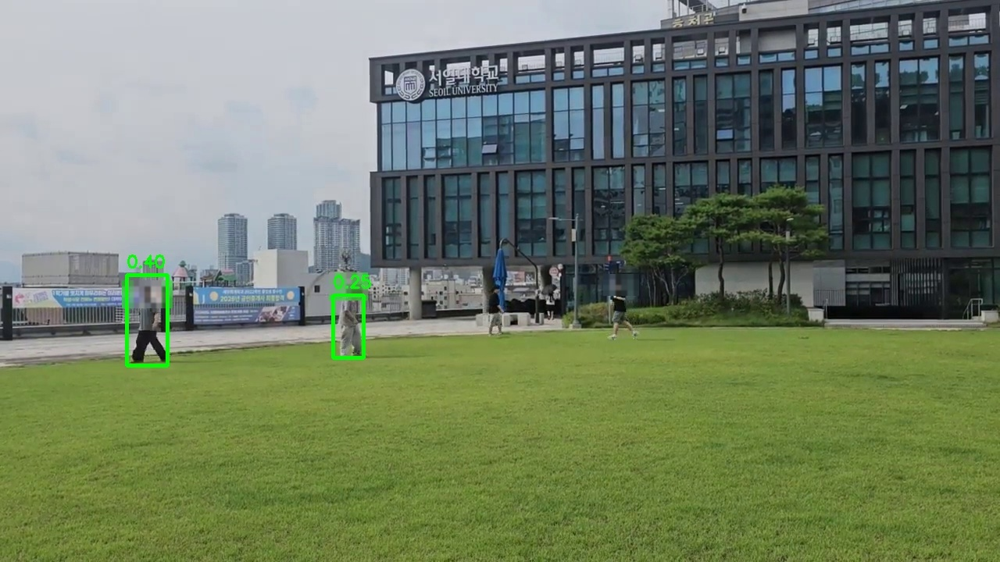
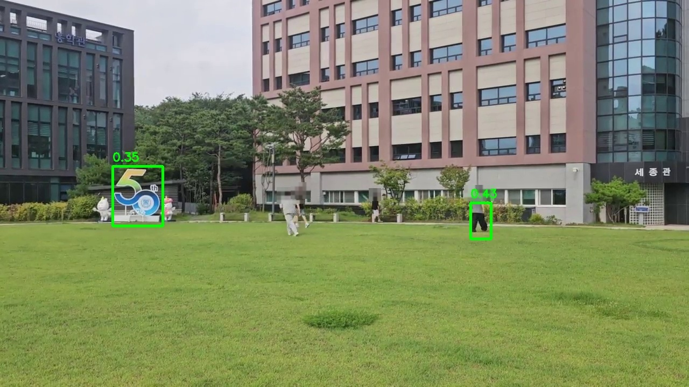

# RC카 실시간 보행자 탐지 (Raspberry Pi 4)

RC카 카메라로 보행자를 실시간 탐지하고, 탐지 위치를 GPS 좌표로 변환해 위성지도에 표시하는 3인 팀 프로젝트에서 **보행자 탐지 모델 파트**를 맡았습니다. 이 저장소는 그중 제가 진행한 모델 학습·개선·배포 작업을 정리한 것입니다.



*왼쪽: 위성지도 위 RC카(초록)와 탐지된 보행자(빨강) 위치 / 오른쪽: RC카 카메라의 실시간 탐지 화면*

**핵심 요약**

- 제공받은 코드에서 박스 크기의 학습 인코딩과 추론 디코딩이 서로 맞지 않는 버그를 발견해 수정했습니다.
- 13회 실험을 모두 같은 평가 기준(conf 0.05, NMS IoU 0.3, VOC AP@0.5)으로 다시 평가해 비교했습니다.
- 파라미터 0.225M, 0.9MB 모델로 RPi4 13~15 FPS를 냈습니다. 데스크톱 CPU 추론은 1.3ms입니다(YOLOv8n은 11.9ms).

## 해결하려던 문제

라즈베리파이 4의 CPU만으로 **초당 8~10프레임 이상** 보행자를 탐지해야 했습니다. 사전학습 YOLOv8n은 정확도는 충분했지만 RPi4에서 이 속도를 내지 못했고, 해상도를 낮추면 정확도가 크게 무너졌습니다. 그래서 **작은 모델의 정확도를 어디까지 끌어올릴 수 있는지**를 실험으로 확인하며, 정확도와 실시간성 사이에서 배포 가능한 지점을 찾는 것이 목표였습니다.

- 기간: 2026.07 – 2026.08 (방학 프로젝트, 3인 팀)
- 데이터: Roboflow People Detection (Train 13,278장 / Valid 1,370장, 단일 클래스 `person`)
- 도구: PyTorch, Ultralytics YOLOv8, ONNX Runtime (C++), OpenCV, Qt6, Raspberry Pi 4

## 역할 구분

| 구분 | 내용 |
|---|---|
| 제공받은 것 | 그리드 기반 탐지 모델의 백본·헤드 구조와 학습 스크립트 뼈대, 카메라·위성지도·좌표변환을 묶은 Qt/C++ 통합 프로그램 원본 (프로젝트를 지도해주신 선배님 제공) |
| 팀원 | 하드웨어·RC카 제어, 좌표 변환·위성지도 투영 (각 팀원 1명) |
| **제가 한 것** | 제공 코드의 학습–추론 인코딩 버그 발견·수정, mAP 평가 도입, YOLOv8n 파인튜닝과 RPi4 실측, 손실 함수·셀 할당·stride·FPN 등 13회 실험 설계와 수행, 전 실험 공통 기준 재평가, 채널 경량화 모델 도출, ONNX 변환과 RPi4 배포, Qt 뷰어 통합 |

## 결과 요약

| 모델 | 파라미터 | 연산량 (MACs) | ONNX 크기 | mAP@0.5 (공통 기준) | 데스크톱 CPU 지연 | RPi4 실측 FPS |
|---|---|---|---|---|---|---|
| YOLOv8n 파인튜닝 (320) | 3.01M | 1,010M | 12.1MB | 0.553 | 11.9ms | 4.4 (LibTorch) / 7.1 (ONNX)† |
| 실험 10: 같은 백본 + 개선된 학습 | 2.87M | 1,491M | 11.5MB | 0.461 | 47.1ms | — |
| **실험 11: 채널 경량화 (최종 배포)** | **0.225M** | **141.6M** | **0.91MB** | **0.375** | **1.3ms** | **13~15** |

† 프로젝트 당시 RPi4 실측. <!-- TODO: 측정 범위 -->

- 목표 속도는 RPi4에서 8~10 FPS였습니다. YOLOv8n은 정확도가 가장 높았지만 목표 속도를 내지 못했고, 해상도를 낮추면 정확도가 크게 무너졌습니다.
- 최종 모델은 YOLOv8n 대비 파라미터 1/13, 연산량 약 1/7이며, 정확도를 내주는 대신 실시간성을 확보한 선택입니다.
- **데스크톱 CPU 지연 측정 조건**: Intel Core i9-10900 (10코어/20스레드, 2.80GHz), ONNX Runtime 1.19.2 CPUExecutionProvider, intra-op 4스레드, 같은 1280×720 영상의 같은 300프레임, 워밍업 30회 후 3라운드 평균. 모델 추론(`session.run`)만 잰 값으로 전처리·후처리는 제외했습니다. 입력은 YOLOv8n 320×320(letterbox), 커스텀 모델 320×240입니다.
- 실험 10은 MACs가 YOLOv8n의 1.5배지만 지연은 약 4배입니다. 해상도가 높은 앞단(60×80, 30×40)에 3×3 일반 컨볼루션 잔차 블록이 있는 구조 때문으로 보입니다(연산자별 프로파일링은 하지 않음). 같은 조건에서 반복해 재도 일관되게 느렸고, PyTorch 4스레드에서도 63.7ms였습니다.
- 저장소의 배포 ONNX(`models/person_detector_lite.onnx`)를 CPU에서 다시 평가하면 mAP@0.5 0.3747로, 학습 중 GPU 배치 평가값(0.3745)과 0.0002 차이가 납니다. 같은 CPU에서는 TorchScript와 ONNX가 똑같이 0.3747이라 변환 손실은 없고, 실행 장치·배치 크기에 따른 부동소수점 연산 차이입니다.



*최종 배포 모델(실험 11, conf 0.25)의 캠퍼스 영상 검출 결과. 행인의 얼굴은 모자이크 처리했습니다.*

## 진행 과정

### 1. 제공 코드의 학습–추론 불일치 버그 발견

베이스 코드를 검토하다가 박스 크기의 학습 인코딩과 추론 디코딩이 서로 역함수가 아니라는 것을 발견했습니다.

```text
[수정 전] 학습: sigmoid(raw) ≈ bw / W     추론: bw = exp(raw) × W
[수정 후] 학습: target = log(bw / W)       추론: bw = exp(raw) × W
```

학습된 값을 다른 함수로 복원하다 보니 박스가 실제보다 크게 부풀었고, 기존 코드의 `tight_factor = 0.85`(박스 일괄 15% 축소)와 "높이가 너비의 3.5배를 넘으면 자르기" 로직은 이 문제를 가리던 임시 조치였습니다. 인코딩을 로그로 통일한 뒤 두 후처리 로직을 제거했습니다.

`scripts/check_box_roundtrip.py`로 검증셋 GT 박스(10,682개)를 학습 코드의 `build_target`으로 인코딩하고 `decode_prediction`으로 복원해 보면, 현재 방식의 최대 좌표 오차는 3.5e-6px(320×240 기준, float32 반올림 수준)입니다. 같은 박스에 수정 전 방식을 적용하면 학습이 타깃을 완벽히 맞췄다고 가정해도 복원 높이가 중앙값 1.16배, 상위 10%는 2.19배 이상으로 부풀고 18.7%의 박스가 1.5배 이상 커집니다(폭은 1.5배 이상이 5.1%). 세로로 긴 보행자 박스일수록 크게 망가지는 구조였습니다.

같은 구조로 학습한 팀원 모델에서도 같은 불일치를 발견했습니다. 가중치는 그대로 두고 학습과 일치하는 디코딩으로 다시 평가하자 mAP@0.5가 0.27에서 0.34로 올랐습니다.

### 2. YOLOv8n 파인튜닝과 배포 한계

COCO 사전학습 YOLOv8n을 파인튜닝해 mAP@0.5 59.2%(320 입력), 65.0%(416 입력)를 얻었습니다(Ultralytics 평가 기준). 이 과정에서 Ultralytics의 `optimizer="auto"`가 사용자가 지정한 `lr0`를 무시하고 학습률을 다시 정한다는 것을 코드에서 확인해, optimizer를 명시하는 방식으로 해결했습니다.

하지만 RPi4 실측(프로젝트 당시)에서 320 입력은 최대 7.1 FPS에 그쳤고, 224·256으로 낮추면 속도는 올라도 정확도가 크게 무너졌습니다. 그래서 더 작은 커스텀 모델의 정확도를 끌어올리는 방향으로 전환했습니다.

### 3. 실험 (13회)

모든 수치는 같은 검증셋(1,370장), 같은 평가 코드, 같은 조건(conf 0.05, NMS IoU 0.3, VOC all-point AP@0.5)으로 다시 측정한 값입니다. 실험 중간에 평가 임계값이 바뀐 구간이 있어, 모든 best 체크포인트를 이 기준으로 재평가해 로그 값을 소수점 넷째 자리까지 재현한 뒤 비교했습니다.

| # | 백본 | 변경 내용 | 에폭 | mAP@0.5 |
|---|---|---|---|---|
| 기준선 | MobileNetV3-Small 앞부분 (사전학습) | SmoothL1 + 다중 양성 셀 할당 | 30 | 0.092* |
| 1 | 〃 | 박스 손실 CIoU | 50 | 0.161 |
| 2 | 〃 | 1번 이어서 학습 | 97 | 0.192 |
| 3 | 〃 | IoU-aware objectness (5에폭 warmup) | 50 | 0.203 |
| 4 | 〃 | Mosaic 증강 | 31 (중단) | 0.134 |
| 5 | 〃 | 언샤프 마스크 전처리 | 50 | 0.190 |
| 6a | 〃 | 입력 416 | 6 (중단) | 0.115 |
| 6b | 〃 | grid stride 16 → 8 | 50 | 0.215 |
| 7 | 〃 | 6b 이어서 학습 | 100 | 0.250 |
| 8 | 〃 | 2레벨 FPN (/8, /16) | 100 | 0.286 |
| 9 | 〃 | FPN 스케일 경계 64px → 48px | 100 | 0.294 |
| 10 | Custom (랜덤 초기화) | 팀원 모델과 같은 백본 + 개선된 학습 방식 | 100 | **0.461** |
| 11 | Custom lite | 10번에서 백본 채널만 축소 (32,64,128,256) → (16,24,32,64) | 100 | **0.375** |
| 13 | MobileNet | FPN + 언샤프를 resize 이전에 적용 | 100 | 0.267 |

\* 기준선은 conf 0.25 기준으로 측정한 값이라 다른 행과 기준이 다릅니다. 12번(경량 백본 + FPN)은 구현과 스모크 테스트까지 했지만 시간 관계상 학습하지 않았습니다. 4번과 6a번은 학습이 중간에 끊긴 실험이라 해당 기법의 성능으로 해석하지 않습니다.

**관찰한 것**

- **IoU-aware objectness**는 confidence가 박스 품질을 반영하도록 바꿉니다. conf 0.25에서 Precision이 0.24(실험 2)에서 0.57(실험 3)로 올랐지만 Recall은 0.31에서 0.18로 떨어져, 운영 임계값을 함께 조정해야 하는 트레이드오프가 생겼습니다. warmup 없이 처음부터 적용하면 학습 초반 박스가 부정확해 objectness 타깃이 거의 0이 되면서 학습이 무너졌습니다(3에폭 mAP ≈ 0).
- **MobileNet 계열은 설정과 무관하게 0.29 근처에서 멈췄습니다.** 사전학습 MobileNetV3-Small의 앞 5블록만 쓴 구조라 파라미터가 약 5.7만 개뿐이었고, 용량을 키운 커스텀 백본(10, 11번)은 둘 다 이를 넘었습니다. 다만 백본·사전학습 여부·용량·에폭이 한꺼번에 바뀌어 각 요인의 기여도는 분리하지 못했습니다.
- **연산량(MACs)과 실제 속도는 비례하지 않았습니다.** 11번은 9번보다 MACs가 2.7배 많지만(141.6M vs 52.5M) 같은 조건의 데스크톱 측정에서 오히려 약 10% 빨랐습니다(1.31ms vs 1.45ms, ONNX Runtime 4스레드). FPN의 2개 헤드와 upsample·lateral 연산처럼 MACs에 잘 드러나지 않는 비용이 있기 때문으로 보입니다(연산자별 프로파일링은 하지 않음).

### 4. 같은 백본에서의 비교와 경량화

10번은 팀원이 학습한 커스텀 모델과 백본·헤드가 완전히 같습니다(파라미터 2,868,677개, 가중치 상호 로드 가능). 같은 평가 기준에서 팀원 모델 0.342(최종 가중치 0.366) 대비 0.461을 얻었습니다. 함께 바뀐 요소는 w/h 로그 인코딩, 다중 양성 셀 할당, CIoU, IoU-aware objectness, 증강 구성, batch size(32 → 64)이며, 요소별 ablation은 하지 않았습니다.

이 학습 방식을 유지한 채 백본 채널만 줄여 RPi4가 감당할 수 있는 크기로 만든 것이 11번 최종 모델입니다.

### 5. RPi4 배포

PyTorch가 ARM용 LibTorch 공식 배포본을 제공하지 않아 RPi4 빌드가 막혀, 추론 백엔드를 ONNX Runtime C++ API로 교체했습니다. 전처리와 디코딩 코드는 그대로 두고 모델 로드·추론 부분만 바꿨습니다.

- 재학습 없이 기존 체크포인트에서 ONNX로 변환, TorchScript 대비 최대 절대오차 4.1e-6 (float32 정밀도 수준)
- Windows에서 먼저 빌드·영상 테스트로 검증한 뒤 RPi4에 반영 (데스크톱 500프레임 연속 테스트에서 크래시 없음)
- RPi4 실측 13~15 FPS (목표 8~10 FPS)
- `deploy/demo_main.cpp`로 RC카 제어 코드 없이 PersonDetector만 단독 실행할 수 있습니다(이미지·영상·카메라 입력에 박스를 그려 표시/저장). Windows 데스크톱(i9-10900, ONNX Runtime 1.20.1 CPU)에서 542프레임 영상을 처리할 때 `detect()` 1회가 프레임당 평균 3.7ms였습니다. 이 값은 결과 요약 표와 조건이 다릅니다: C++ `PersonDetector`의 기본 설정인 intra-op **1스레드**이고, 추론뿐 아니라 전처리·디코딩·NMS·박스 그리기까지 포함한 시간입니다. 같은 모델의 추론만 Python에서 재면 1스레드 2.6ms, 4스레드 1.3ms입니다.

## 한계와 향후 과제

- **오탐과 정탐의 confidence 분포가 겹칩니다.** 실제 주행 영상에서 세로로 긴 조형물과 풀숲을 conf 0.26~0.35로 보행자로 오인했고, 임계값을 0.35 이상으로 올리면 실제 보행자도 놓쳤습니다. 임계값 조정으로는 해결되지 않아, 주행 환경의 오탐 배경을 수집해 negative 샘플로 재학습하는 hard negative mining이 필요하다고 판단했습니다.

  

  *왼쪽의 숫자 모양 조형물을 conf 0.35로 사람으로 오인한 장면(오른쪽 0.43은 실제 보행자). 행인 얼굴은 모자이크 처리했습니다.*
- 원거리 보행자나 여러 명이 겹친 장면에서 일부를 놓칩니다.
- 박스 인코딩 왕복 검증(`scripts/check_box_roundtrip.py`)을 하다가, 검증셋 GT 10,682개 중 약 17%(1,833개)가 `build_target` 단계에서 학습 타깃에 들어가지 못한다는 것을 확인했습니다. 할당될 셀을 이미 다른 박스가 차지하는 경우 등이 이유로 보입니다. 학습셋에서도 같은 일이 생긴다면 밀집 장면에서 놓치는 원인 후보 중 하나일 수 있습니다. 다만 학습셋 비율과 실제 미탐과의 관계는 확인하지 않았습니다. 향후에는 한 셀에서 여러 박스를 예측하는 구조를 검토할 수 있습니다.
- 모든 수치는 best 체크포인트를 고른 검증셋에서 잰 값이라 약간 낙관적일 수 있으며, 별도 test split으로는 평가하지 않았습니다.
- YOLOv8n은 letterbox, 커스텀 모델은 320×240 stretch resize로 입력 전처리가 달라 완전히 같은 조건의 비교는 아닙니다.

## 실행 방법

모든 명령은 저장소 루트에서 실행합니다.

**환경**: Python 3.9.25, PyTorch 2.5.1 (CUDA 12.1 빌드), ONNX Runtime 1.19.2 (Python) / 1.20.1 (C++ SDK), OpenCV 5.0.0 (Python `opencv-python`) / 4.12.0 (C++ 데모 Windows 빌드). RPi4는 `onnxruntime-linux-aarch64` 공식 배포본을 사용합니다.
<!-- TODO: RPi4에서 사용한 OS·OpenCV·ONNX Runtime 버전 -->

```bash
pip install -r requirements.txt
# GPU로 학습하려면 CUDA 빌드 torch를 따로 설치
pip install torch==2.5.1 torchvision==0.20.1 --index-url https://download.pytorch.org/whl/cu121
```

**1. 데이터 준비**: 아래 [데이터셋](#데이터셋) 항목의 폴더 배치대로 `archive/`에 둡니다. 모든 스크립트는 `--data-root`로 위치를 지정합니다(기본값 `./archive`).

**2. 학습** (최종 배포 모델, 실험 11 설정)

```bash
python training/train_person_detector.py --data-root ./archive --backbone custom --no-pretrained \
  --custom-channels 16 24 32 64 --iou-aware --iou-aware-warmup 5 --epochs 100 \
  --batch-size 64 --lr 1e-3 --conf-threshold 0.05 --output-dir ./runs/11_custom_lite
```

- 실험 11 체크포인트에 저장된 학습 인자에서 복원한 명령입니다. 나머지 옵션은 기본값입니다(입력 320×240, grid stride 16, NMS IoU 0.3, Adam weight decay 1e-4, ReduceLROnPlateau patience 3).
- 실험 10은 `--custom-channels`를 빼면 됩니다(기본 채널 32,64,128,256).
- `--output-dir`에 `best_model.pth`(검증 mAP 최고 가중치), `person_detector.pth`(마지막 체크포인트, `--resume`으로 이어서 학습), `person_detector_script.pt`(best 가중치의 TorchScript), `training_history.png`가 저장됩니다.

**3. 평가** (공통 기준: conf 0.05, NMS IoU 0.3, VOC AP@0.5 — 모두 기본값)

```bash
python training/evaluate_model.py --weights models/person_detector_lite.onnx --data-root ./archive
```

- `.onnx`는 ONNX Runtime으로, `.pt`(TorchScript)는 PyTorch로 불러와 같은 디코딩·AP 코드로 평가합니다.
- 저장소의 ONNX를 CPU에서 평가하면 mAP@0.5 0.3747, Recall(IoU 0.3) 0.6044가 나옵니다.

**4. ONNX 변환** (학습 결과 TorchScript → ONNX, 재학습 없음)

```bash
python scripts/export_onnx.py --torchscript runs/11_custom_lite/person_detector_script.pt \
  --output models/person_detector_lite.onnx
```

- opset 17, 입력 1×3×240×320. 변환 후 ONNX Runtime 출력과 TorchScript 출력의 최대 절대오차를 출력합니다.
- 실험 11의 `person_detector_script.pt`로 다시 변환하면 저장소의 ONNX와 출력이 완전히 같습니다(차이 0).

**5. 영상 추론 확인** (Python)

```bash
python training/detect_video.py --source <영상 파일 경로>     # 웹캠은 --source 0
python training/detect_video.py --source <영상> --save out.mp4 --no-display
```

- 기본 모델 `models/person_detector_lite.onnx`, conf 0.25, NMS IoU 0.3. 종료는 `q`.

**6. C++ 데모 빌드와 실행** (`deploy/`, PersonDetector 단독)

Windows (Visual Studio 2019, 실제로 빌드·실행 확인):

```bat
cmake -S deploy -B build -G "Visual Studio 16 2019" -A x64 ^
  -DOpenCV_DIR=<opencv>/build -DONNXRUNTIME_ROOT=<onnxruntime-win-x64-1.20.1 경로>
cmake --build build --config Release
build\Release\person_detector_demo.exe models\person_detector_lite.onnx <이미지|영상|카메라 번호> --save out.jpg
```

- OpenCV DLL 폴더(`<opencv>/build/x64/vc16/bin`)가 PATH에 있어야 합니다. onnxruntime DLL은 빌드할 때 실행 파일 옆에 자동 복사됩니다.
- 옵션: `--conf`(기본 0.25), `--nms`(기본 0.3), `--save <경로>`, `--no-display`.

Linux / RPi4:

```bash
sudo apt install cmake libopencv-dev
curl -LO https://github.com/microsoft/onnxruntime/releases/download/v1.20.1/onnxruntime-linux-aarch64-1.20.1.tgz
tar xzf onnxruntime-linux-aarch64-1.20.1.tgz
cmake -S deploy -B build -DONNXRUNTIME_ROOT=$PWD/onnxruntime-linux-aarch64-1.20.1
cmake --build build
./build/person_detector_demo models/person_detector_lite.onnx <이미지|영상|카메라 번호>
```

<!-- TODO: 이 데모를 RPi4에서 빌드·실행 확인 (Windows에서만 확인함). RC카 전체 앱(카메라·모터·GPS 제어)은 이 저장소에 포함하지 않음 -->
**7. 박스 인코딩 왕복 검증**

```bash
python scripts/check_box_roundtrip.py --data-root ./archive
```

**YOLOv8n 베이스라인** 라벨 변환과 학습 명령은 [training/baseline/README.md](training/baseline/README.md)에 있습니다.

## 저장소 구조

```text
.
├── README.md
├── requirements.txt
├── training/
│   ├── train_person_detector.py   # 학습·검증 스크립트 (실험 1~13 공통)
│   ├── evaluate_model.py          # mAP 단독 평가 (ONNX / TorchScript)
│   ├── detect_video.py            # 영상·웹캠 추론 (Python)
│   └── baseline/
│       ├── README.md              # YOLOv8n 베이스라인 학습 명령과 결과
│       └── convert_to_yolo.py     # YOLOv8n 베이스라인용 라벨 변환 (CSV → YOLO txt)
├── scripts/
│   ├── export_onnx.py             # TorchScript → ONNX 변환 + 출력 일치 검증
│   └── check_box_roundtrip.py     # 박스 인코딩→디코딩 왕복 오차 검증
├── deploy/
│   ├── PersonDetector.h / .cpp    # ONNX Runtime C++ 추론
│   ├── demo_main.cpp              # PersonDetector 단독 데모
│   └── CMakeLists.txt             # 데모 빌드 (Windows / Linux)
├── models/
│   └── person_detector_lite.onnx  # 최종 배포 모델 (실험 11, 0.91MB)
├── experiments/
│   ├── logs/                      # 실험별 학습 로그 19개 (UTF-8, 파일명 앞 번호 = 실험 번호)
│   └── plots/                     # 실험별 학습 곡선 11개 (중단·미실행 실험은 없음)
└── docs/                          # README 이미지 (시연 화면, 검출 결과; 행인 얼굴 모자이크 처리)
```

## 데이터셋

[Roboflow Universe - People Detection](https://universe.roboflow.com/leo-ueno/people-detection-o4rdr) (Train 13,278장 / Valid 1,370장, 단일 클래스 `person`). Pascal VOC 2012, MOT17 등 여러 공개 데이터를 합친 데이터셋으로 대부분 CC BY 4.0 라이선스입니다. 용량 문제로 이미지는 저장소에 포함하지 않았습니다.

**받는 방법과 폴더 배치**

- 버전: 학습에 쓴 사본의 `README.dataset.txt` 기준 **"People Detection > 2025-03-31 9:04pm"** (전체 17,401장: train 15,210 / valid 1,431 / test 760).
- 형식: 분할(train/valid/test)마다 이미지 파일과 `_annotations.csv` 한 개. CSV 열은 `filename,width,height,class,xmin,ymin,xmax,ymax`(픽셀 좌표, 클래스 `person`)입니다. Roboflow 데이터셋 페이지에서 이 열 구성의 CSV 형식으로 내보내 받습니다.
  <!-- TODO: 학습에 쓴 사본에는 README.roboflow.txt가 없어 Roboflow 내보내기 옵션 이름과 다운로드 경로(Roboflow 직접 / 다른 미러)를 확인하지 못함 -->
- 압축을 풀어 분할 이름이 두 번 겹치는 구조로 둡니다. 학습·평가 스크립트는 `<data-root>/<split>/<split>/_annotations.csv`를 읽습니다.

```text
archive/
├── train/train/   # 이미지 + _annotations.csv
├── valid/valid/   # 이미지 + _annotations.csv
└── test/test/     # 이미지 + _annotations.csv (이 프로젝트의 평가에는 사용하지 않음)
```

- CSV에 `person` 박스가 있는 이미지만 학습·평가에 쓰이며, 그 결과가 Train 13,278장 / Valid 1,370장입니다.

**출처 표기**

- 데이터셋: *People Detection*, Roboflow Universe 사용자 leo-ueno 제공 (2025-03-31 버전), https://universe.roboflow.com/leo-ueno/people-detection-o4rdr — 데이터셋 자체의 라이선스는 원문에 `undefined`로 표기돼 있습니다.
- 이 데이터셋이 사용한 Universe 프로젝트와 라이선스는 아래에 원문 표기 그대로 적었습니다.

<details>
<summary>원본 데이터 출처 14개 펼치기</summary>

- [First Pedestrian Test](https://universe.roboflow.com/safer-strides/first-pedestrian-test) — CC BY 4.0
- [person_camera_security1](https://universe.roboflow.com/chinh/person_camera_security1) — CC BY 4.0
- [Human Action Recognition 2000](https://universe.roboflow.com/skripsi-u18dy/human-action-recognition-2000) — CC BY 4.0
- [People Detection](https://universe.roboflow.com/chris-kydks/people-detection-2csbw) — CC BY 4.0
- [contador-de-gente teste 3](https://universe.roboflow.com/mackleaps/contador-de-gente-teste-3) — CC BY 4.0
- [OD3](https://universe.roboflow.com/object-detection-tuphv/od3-fq4yp) — CC BY 4.0
- [Person Detection](https://universe.roboflow.com/illimited/person-detection-gbuka) — CC BY 4.0
- [MOT17-03-DPM](https://universe.roboflow.com/bhu-ykklm/mot17-03-dpm-udorc) — 라이선스 표기 없음
- [The Curve](https://universe.roboflow.com/people-8gcmt/the-curve-02) — CC BY 4.0
- [pedestrain safety](https://universe.roboflow.com/intel-9horw/pedestrian-safety-obyfo) — CC BY 4.0
- [People Detection](https://universe.roboflow.com/jmedel/people-detection-f0fgt) — CC BY 4.0
- [people、rabish](https://universe.roboflow.com/cpk-wow-k5nlf/people-rabish) — CC BY 4.0
- [Pascal VOC 2012](https://universe.roboflow.com/jacob-solawetz/pascal-voc-2012) — CC BY 4.0
- [Person Detection (General)](https://universe.roboflow.com/mohamed-traore-2ekkp/people-detection-general) — CC BY 4.0

</details>

- CC BY 4.0 전문: https://creativecommons.org/licenses/by/4.0/
- 이 저장소는 데이터셋 이미지를 재배포하지 않고 학습 결과(모델·로그)만 포함합니다.
